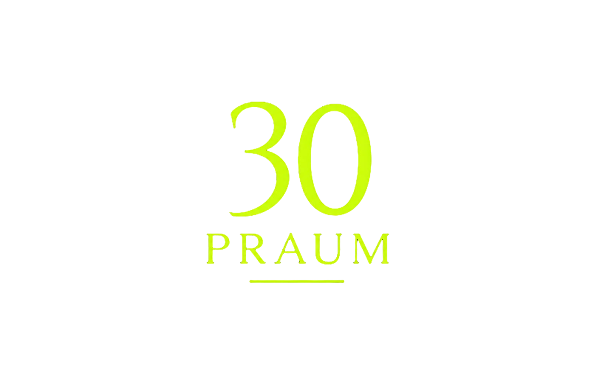

  

<h1 align="center">30PRAUM · Projeto de fã</h1>

  Projeto acadêmico da Escola Técnica de São Paulo (SPTECH) · Faculdade de Tecnologia · 2026  
  Site de fã com artistas, playlist com prévias de músicas, quiz e sistema de cadastro e login com banco de dados.

> Projeto de fã, não oficial e sem fins lucrativos. Não é afiliado ao 30PRAUM nem aos artistas.

---

## Funcionalidades 

- **Início e artistas:** apresentação do projeto e dos artistas.
- **Playlist:** busca prévias de 30 segundos pela iTunes Search API e permite montar a própria playlist.
- **Quiz:** perguntas sobre os artistas.
- **Jogo da memória:** jogo da memória para achar pares dos símbolos que representam a 30praum.
- **Cadastro:** grava nome, e-mail e senha no banco de dados, com validação de e-mail e medidor de força da senha (Fraca, Média ou Forte). Senha fraca é bloqueada.
- **Login:** confere e-mail e senha no banco e mostra a tela "Olá, (nome)" com o botão de sair.
- **Página da Dashboard:** mostra a visão pública e individual para o usuário depois de realizar o quiz e estar logado no site.

## Tecnologias

- HTML, CSS e JavaScript 
- Node.js e Express (API)
- MySQL (banco de dados)

## Autoria

Feito por [@MartinsMirela](https://github.com/MartinsMirela).
